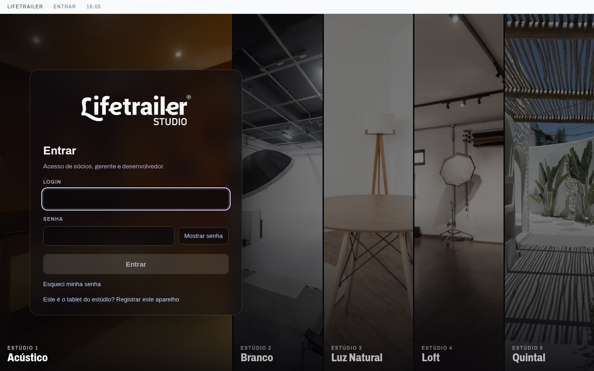
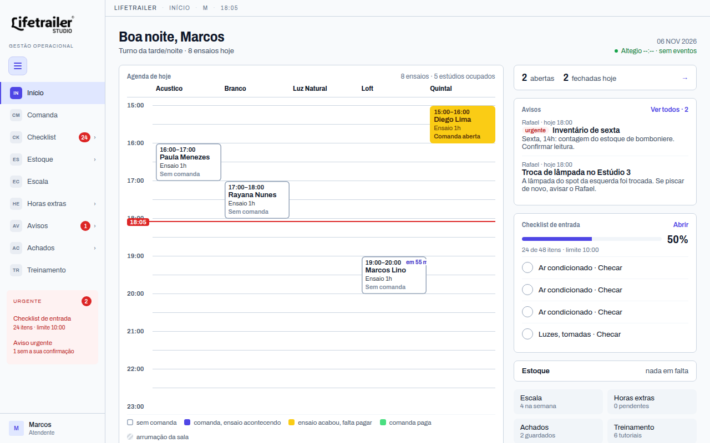
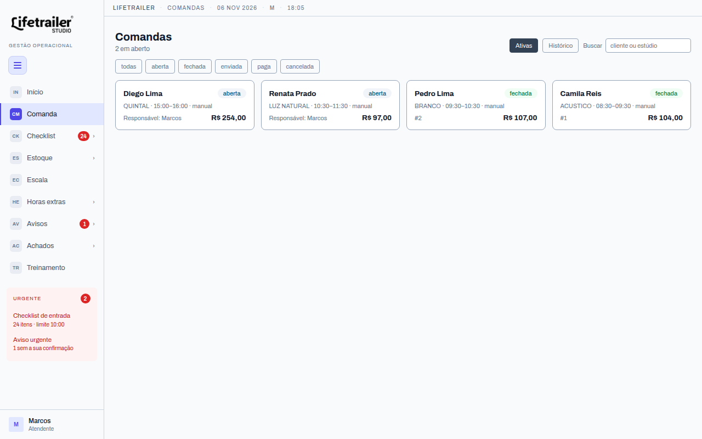
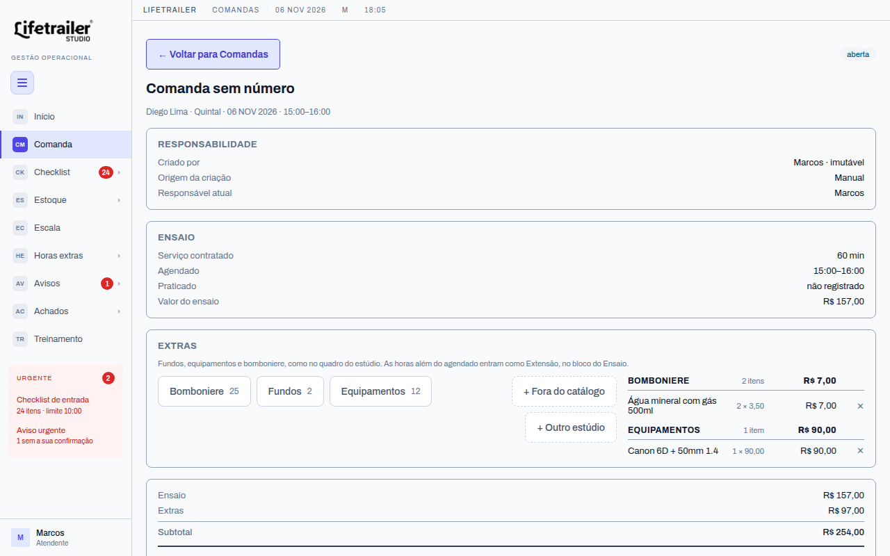
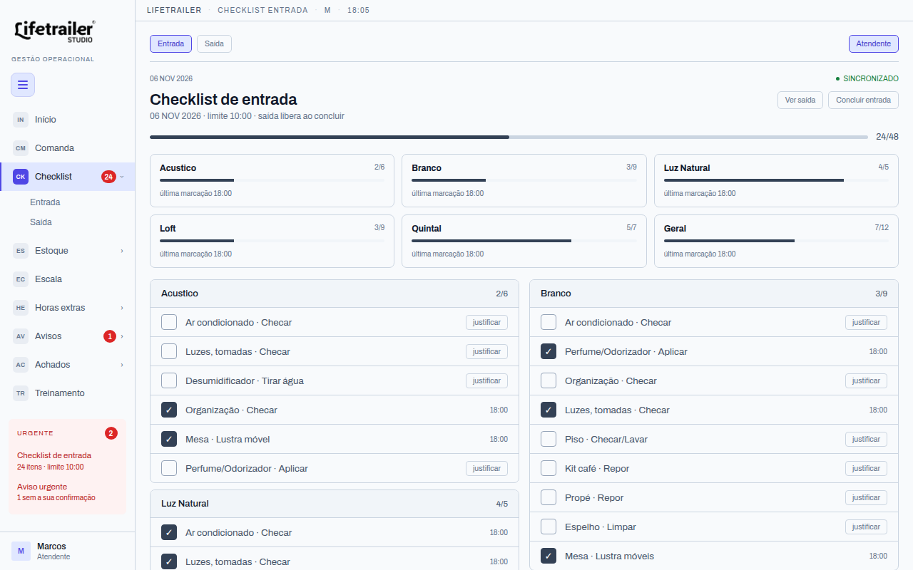
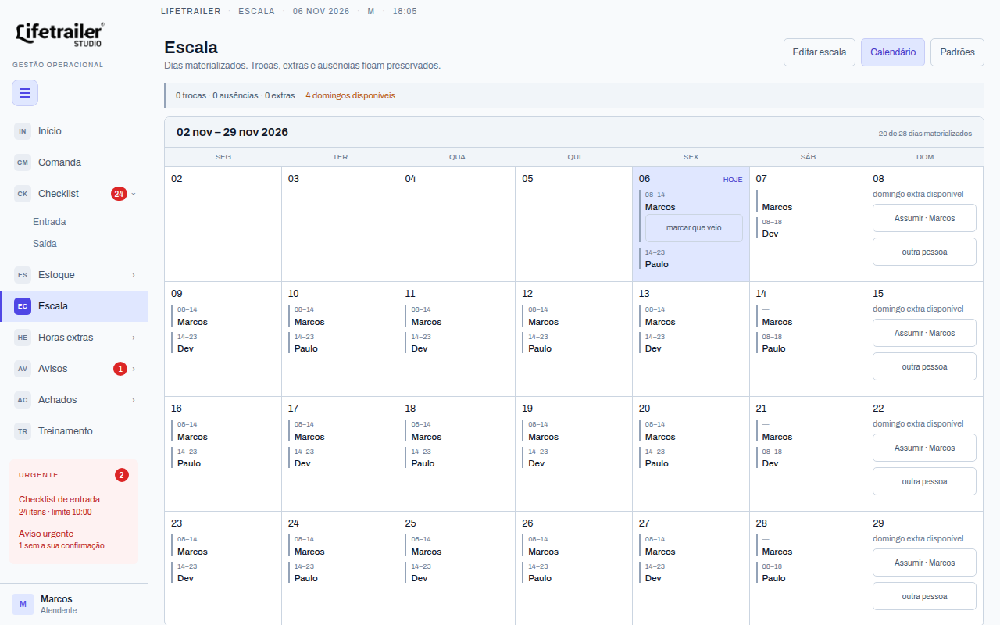
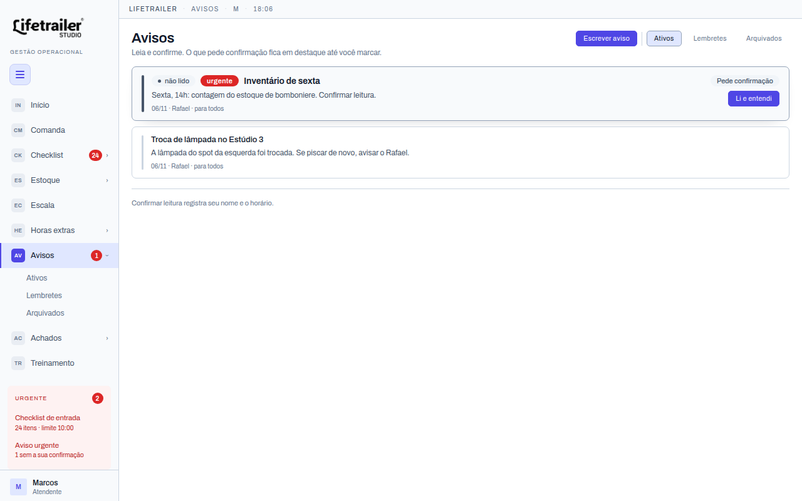
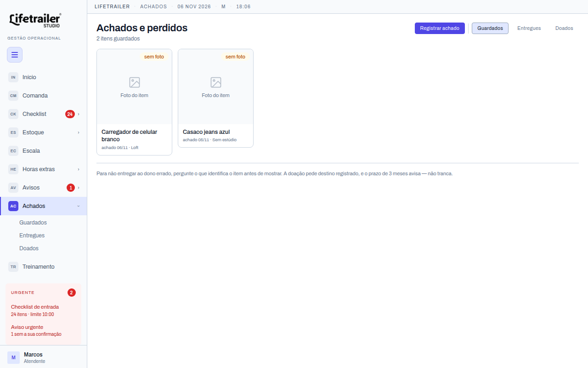
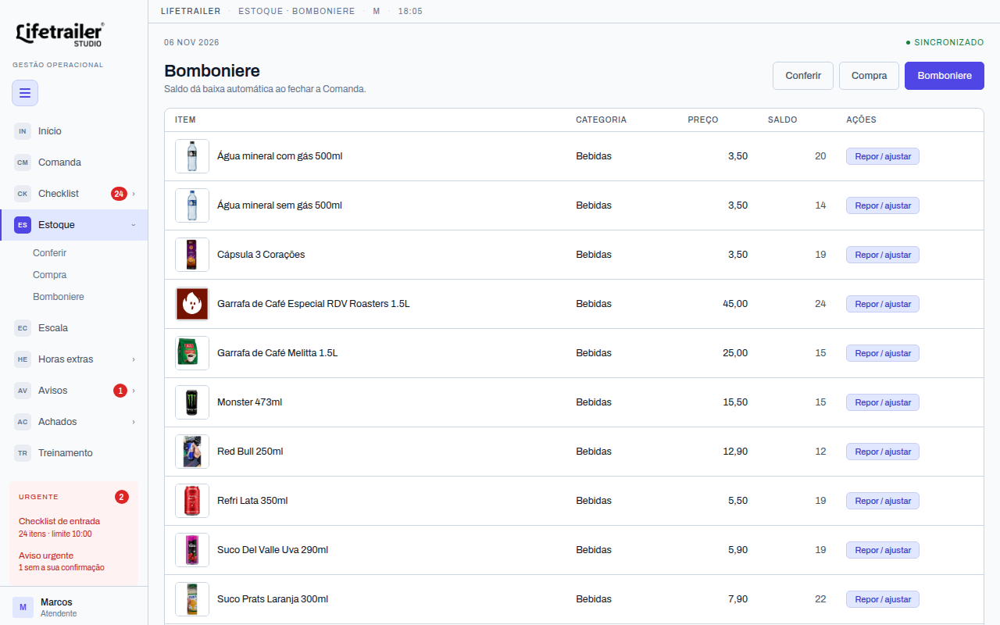

# Lifetrailer Studio

**Sistema que a equipe de um estúdio de fotografia usa todo dia, num tablet no balcão. Eu desenhei, decidi e entrego.**

[](https://github.com/Thiago-Mateus0/lifetrailer-studio/actions/workflows/ci.yml)


Trabalho num estúdio de fotografia. A operação rodava em quadro, papel e caderno: comanda perdida, estoque que nunca batia, hora extra calculada de cabeça. Em vez de reclamar, construí o sistema que resolve isso. Ele substitui o papel, lê a agenda do **Altegio** (a plataforma de agendamento que o estúdio já usava) e **está em produção**.

Sou estudante de Ciência da Computação (2º período) e este é meu projeto principal. Este repositório é a cópia de portfólio: nomes, documentos fiscais, IDs do Altegio e fotos da equipe são fictícios. **Código, testes e documentação são os do sistema real.**

## Se você tem 5 minutos

O que mais diz sobre como eu trabalho, em ordem:

1. **[`tests/db/05_fsm_comanda.sql`](tests/db/05_fsm_comanda.sql)**: a máquina de estados da Comanda, com cada transição testada no banco.
2. **[`docs/spec/audit-log.md`](docs/spec/audit-log.md)**: log de auditoria append-only com hash encadeado e verificação de integridade.
3. **[`docs/adr/`](docs/adr/)**: mais de 90 decisões registradas, uma por arquivo, incluindo as que mudei de ideia e revoguei.
4. **[`docs/processo-de-trabalho.md`](docs/processo-de-trabalho.md)**: como uso IA, sem enfeite (resumo abaixo).

## O que faz a diferença neste projeto

- **O banco é o guardião do dinheiro.** Operação de vários passos é função PL/pgSQL, atômica. O cliente nunca monta uma transação financeira com várias chamadas, então nenhum estado fica pela metade.
- **Segurança em camadas.** RLS por papel (app / job / admin), o app só chama funções de uma allow-list, e o tablet se identifica por chave de dispositivo com sessão derivada no servidor.
- **Auditoria que não dá pra maquiar.** Cada mutação relevante entra num log append-only. Cada linha carrega o hash da anterior, e há função de verificação.
- **Altegio é a fonte da verdade.** O sync é só de ida (webhook, Altegio → Lifetrailer). O sistema nunca escreve de volta e nunca trata o dado local de agendamento como autoritativo.
- **Número vem do CSV, nunca do texto.** Preço, turno e catálogo moram em `data/`. Já errei contagem de estoque duas vezes por ter número escrito num parágrafo, e transformei o erro em regra.
- **Migrations sem superuser.** Rodam como no banco gerenciado de produção e são validadas na CI, do zero, a cada PR ([ADR 0077](docs/adr/0077-migrations-sem-superuser.md)).

## Telas

Tablet em modo kiosk (capturas em 1280×800, com os dados de demonstração de `scripts/seed-demo*.sql`).

| | |
|---|---|
|  **Entrada**: login do administrador; o tablet só mostra a equipe depois de registrado |  **Início**: agenda do dia por estúdio, com a cor da Comanda de cada ensaio |
|  **Comandas**: filtro por estado da máquina de estados |  **Comanda**: responsável, ensaio, extras e subtotal |
|  **Checklist** de entrada por estúdio, com justificativa |  **Escala**: calendário de turnos, com domingos extras disponíveis |
|  **Avisos** com confirmação de leitura |  **Achados e perdidos** |
|  **Bomboniere**: baixa automática ao fechar a Comanda | |

## Módulos

| Módulo | Para quê |
|---|---|
| **Comanda** | Atendimento do começo ao fim: abrir, lançar itens, fechar, enviar comprovante. É o módulo mais complexo: máquina de estados multi-etapa. |
| **Checklist** | Rotina de abertura/fechamento do turno, com justificativa e foto quando algo não é feito. |
| **Estoque / Inventário** | Insumos e bomboniere, com reconciliação automática. |
| **Escala** | Turnos, trocas, faltas e volta ao padrão. |
| **Horas extras** | Cálculo por turno, com regras de borda (saída antecipada, posse do turno). |
| **Avisos e Achados e Perdidos** | Comunicação interna com confirmação de leitura; registro de objetos com foto. |

## Arquitetura

```
 Altegio ──webhook──▶  Processo Node  ──▶  PostgreSQL gerenciado
 (agenda)              (webhook + API       ├─ PL/pgSQL: toda escrita financeira
                        + serve o app)      ├─ RLS por papel (app / job / admin)
                              ▲             ├─ audit log append-only, hash encadeado
                              │             └─ pg_cron: jobs diários
                      SPA/PWA React (tablet em kiosk)
```

Produção: droplet + Postgres gerenciado (DigitalOcean), Caddy na frente. Passo a passo em [`deploy/`](deploy/).

### Decisões que valem uma olhada

| Tema | Onde ler |
|---|---|
| FSM da Comanda: toda transição é explícita e tem teste | [`docs/spec/comanda.md`](docs/spec/comanda.md) |
| Audit log imutável com cadeia de hash | [`docs/spec/audit-log.md`](docs/spec/audit-log.md), `tests/db/04`, `09`, `11` |
| Fronteira entre app e banco: só funções permitidas | [ADR 0042](docs/adr/0042-fronteira-entre-o-app-e-o-banco.md) |
| Identidade do tablet: chave por dispositivo, sessão no servidor | [ADR 0048](docs/adr/0048-identidade-do-dispositivo.md) |
| Saí do Supabase para Postgres gerenciado, e por quê | [ADR 0016](docs/adr/0016-sai-do-supabase.md), [0018](docs/adr/0018-volta-a-postgres-gerenciado.md) |
| Topologia de produção | [ADR 0063](docs/adr/0063-topologia-de-producao.md) |

**ADR aceito não se edita.** Mudei de ideia? Escrevo outro ADR que revoga o antigo. Spec diz *o que* o sistema faz; ADR diz *por que*.

## Como eu uso IA (e onde ela não decide)

Boa parte do código foi escrita com agentes (Claude Code, e Codex em tarefa mecânica). Vai aparecer commit assinado por IA no histórico, e eu não escondo.

O que é meu: a spec, o ADR, a FSM da Comanda, toda regra de dinheiro e o que fica em `docs/pendencias.md`. O agente implementa dentro de um escopo que eu já fechei, roda os testes, e **eu leio e faço o merge**. Regra de dinheiro só entra no código com teste cobrindo as leituras possíveis dela. Dez testes verdes não provam nada se os dez testam a mesma interpretação errada. Detalhes em [`docs/processo-de-trabalho.md`](docs/processo-de-trabalho.md).

## Testes

| Camada | Ferramenta | Pasta |
|---|---|---|
| Banco (FSM, RLS, travas financeiras, audit log, jobs) | pgTAP | `tests/db/` |
| API, webhook, jobs, carga de catálogo | `node --test` | `tests/api`, `tests/webhook`, `tests/jobs`, `tests/carga` |
| Front | Vitest + Testing Library | `src/app/src` |
| Domínio (CSV e docs) | Python | `tests/runner.py` |

A CI sobe o Postgres pelo mesmo `docker-compose.yml` do desenvolvimento, aplica as migrations **do zero** e roda tudo.

## Rodando localmente

Requer Docker, Node 22+ e `psql`.

```bash
bash scripts/dev-db.sh docker          # Postgres 16 + pgTAP + pg_cron
node src/db/migrate.mjs                # aplica as migrations
node src/db/carga.mjs                  # catálogos iniciais (dados fictícios em data/)

# webhook + app no mesmo processo; os dois segredos são obrigatórios (32+ caracteres)
LT_WEBHOOK_TOKEN=... LT_CLAIM_SEGREDO=... node src/webhook/index.mjs
npm --prefix src/app run dev           # front com Vite
```

<details>
<summary><b>Ver o sistema com dados de demonstração</b> (banco descartável, tudo fictício)</summary>

```bash
export PGHOST=127.0.0.1 PGUSER=postgres PGDATABASE=lifetrailer_demo
psql -d postgres -c "create database lifetrailer_demo"
node src/db/migrate.mjs && node src/db/carga.mjs
psql -v ON_ERROR_STOP=1 -f scripts/seed-demo.sql         # equipe, escala, agenda de hoje, checklist
psql -v ON_ERROR_STOP=1 -f scripts/seed-demo-vida.sql    # comandas, avisos, achados
node src/db/dispositivo.mjs registrar "Tablet 01"        # imprime a chave do aparelho (uma vez)
```

Suba o servidor como `lifetrailer_app` (`PGUSER=lifetrailer_app`, mais os dois segredos) e o front com Vite. Cole a chave em "Registrar este aparelho".

- Atendentes: Marcos `1111`, Paulo `2222`, Dev `3333`
- Administradores: `helena` ou `rafael`, senha `demo-portfolio-2026`

Roteiro para ver os seis módulos ponta a ponta: [`docs/roteiro-demo.md`](docs/roteiro-demo.md).
</details>

Testes:

```bash
LT_BANCO_TESTE=lt_teste_local bash scripts/test-db.sh pgtap
LT_BANCO_TESTE=lt_teste_local bash scripts/test-db.sh node
npm --prefix src/app run test
```

## Estrutura

```
src/db/        migrations append-only e scripts do banco
src/api/       montagem das telas a partir do banco
src/webhook/   entrada do Altegio + servidor
src/jobs/      jobs do pg_cron e do carteiro
src/app/       front React/TypeScript
docs/spec/     o que o sistema faz, por área
docs/adr/      por que cada decisão foi tomada
docs/design/   design system e mockups
data/          CSVs: preço, catálogo, turnos (fonte de verdade para números)
deploy/        produção
tests/         pgTAP, Node, domínio
```

## Licença

Sem licença de reuso: todos os direitos reservados. O código está visível para avaliação do meu trabalho, e não para ser copiado ou redistribuído. Os dados em `data/` e as capturas são de demonstração.

## Sobre mim

**Thiago Mateus**, estudante de Ciência da Computação. Gosto de banco de dados, de sistema que não perde dado e de documentar o porquê das decisões. Estou procurando estágio.

- GitHub: [@Thiago-Mateus0](https://github.com/Thiago-Mateus0)
- E-mail: thiagomateus2008@gmail.com
